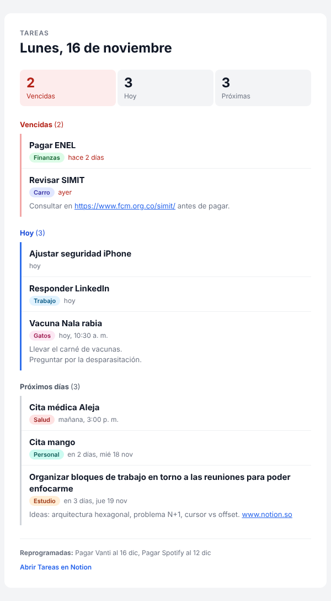

# Notion_Lambda_Service

AWS Lambda (Python 3.12) that reads the Notion database "Tareas", reopens
recurring tasks, and emails a daily digest in Spanish through AWS SES.

Each run:

1. Reopens recurring tasks marked `Done` (see [Recurring tasks](#recurring-tasks)).
2. Queries pending tasks (`Not Started` or `In Progress`) with `Fecha` on or
   before today + `UPCOMING_DAYS`, following Notion pagination.
3. Sends an email with three sections: Vencidas, Hoy and Próximos días.
   Empty sections are hidden. If nothing is pending, the run still succeeds
   and no email is sent unless `SEND_EMPTY_DIGEST=true`.

"Today" is computed in `TIMEZONE` (default `America/Bogota`), not in UTC.



## Notion database

| Property | Type | Use |
| --- | --- | --- |
| `Tarea` | title | Task name (all rich text fragments are joined) |
| `Fecha` | date | Due date; a time is shown when the date has one |
| `Status` | status | Not Started, In Progress, Done, Archived |
| `Notas` | rich text | Shown under the task, URLs become links |
| `Área` | select | Hogar, Gatos, Carro, Finanzas, Trabajo, Salud, Personal, Estudio |
| `Recurrencia` | select | Semanal, Quincenal, Mensual, Bimestral, Trimestral, Semestral, Anual |

The Notion integration needs the **Read content** and **Update content**
capabilities (notion.so/profile/integrations). Without Update content the
recurring tasks cannot be reopened; the email then shows a warning.

### Recurring tasks

Each recurring bill is a single page that is reused; no new pages are
created. For every task with `Status = Done` (the checkbox in the "Todo" view)
and a `Recurrencia` value, the Lambda:

- computes the next date from the task's own `Fecha` (not from today),
  advancing exactly one interval (Semanal = 7 days, Quincenal = 14 days,
  the rest are calendar months);
- sets `Status = Not Started` and the new `Fecha` in a single PATCH, so the
  task shows up unchecked again. A second run the same day finds it
  `Not Started` and does nothing, so the process is idempotent;
- keeps the time of day when `Fecha` has one;
- lists it at the end of that day's email under "Reprogramadas hoy", with the
  old and new date. The email is sent even if nothing else is pending.

Tasks that are not checked are never moved: an unpaid bill keeps showing in
"Vencidas" until you check it. If it is checked late, it still advances one
interval from its own date, so a missed month shows up as overdue.

End of month: a task on the 31st moves to the last day of shorter months
(31 Jan to 28 Feb) and then keeps that day. None of the current recurring
tasks fall on the 29th to 31st.

## Configuration

| Variable | Default | Description |
| --- | --- | --- |
| `NOTION_API_KEY` | required | Notion integration token |
| `NOTION_DATABASE_ID` | required | Id of the "Tareas" database |
| `NOTION_VERSION` | `2022-06-28` | Notion API version (see note below) |
| `NOTION_BASE_URL` | `https://api.notion.com/v1` | Notion API base URL |
| `NOTION_DATABASE_FILTER_PROPERTIES` | `Notas,Tarea,Fecha,Área` | Properties returned by the pending query; `Tarea`, `Fecha`, `Notas` and `Área` are always added |
| `NOTION_TASKS_URL` | `https://www.notion.so/<database id>` | Link in the email footer |
| `SES_SENDER_EMAIL` | required | Verified SES sender |
| `SES_RECEIVER_EMAIL` | required | Recipient |
| `TIMEZONE` | `America/Bogota` | IANA time zone used for "today" and every date in the email |
| `UPCOMING_DAYS` | `3` | Days ahead shown in "Próximos días" |
| `SEND_EMPTY_DIGEST` | `false` | Send a short "Nada pendiente hoy" email when nothing is pending |
| `LOG_LEVEL` | `INFO` in production, `DEBUG` locally | DEBUG, INFO, WARNING, ERROR |
| `AWS_REGION` | `us-east-1` | SES region |

`tzdata` is a dependency so time zones do not depend on the Lambda image.

Notion API version: `POST databases/{id}/query` is marked as deprecated
starting with `2025-09-03` (databases split into data sources), but
integrations on `2022-06-28` keep working for databases with a single data
source and no end of life date has been announced. "Tareas" has one data
source, so the service stays on `2022-06-28`. If someone adds a second data
source, Notion answers 400 `multiple_data_sources_for_database`; that is the
signal to migrate to `data_sources/{id}/query`.

## Local setup

```bash
python3.12 -m venv .venv
source .venv/bin/activate
pip install -r requirements-dev.txt   # includes requirements.txt
cp sample.env .env                    # then edit .env
chmod +x scripts/*.sh
```

Scripts use `zsh`.

## Running locally

```bash
scripts/lint.sh                 # black + flake8
scripts/run_tests.sh            # pytest with coverage (fails under 75%)
scripts/invoke_local.sh         # runs the handler with {} (sends a real email)
python scripts/preview_email.py # writes preview/email.html with sample tasks
```

`preview/` is git ignored. Open `preview/email.html` in a browser to check the
design; `preview/email.txt` is the plain text alternative.

## Development workflow

1. Work on a `feature/...` branch, run `scripts/lint.sh` and
   `scripts/run_tests.sh`.
2. Merge into `develop` and push. **A push to `develop` ends in production.**
3. CI runs lint, opens or updates a PR `develop -> main`, runs SonarCloud and,
   if the Quality Gate passes, merges it automatically with a merge commit.
4. The push to `main` deploys to AWS.
5. Sync locally:
   ```bash
   git checkout main && git pull origin main
   git checkout develop && git merge main
   ```

A merge commit (not squash) is used on purpose: `develop` is a long lived
branch, and squashing would rewrite its commits on `main` so both branches
would diverge after every release.

## CI/CD

- `.github/workflows/ci-develop.yml`: push to `develop` runs Black and Flake8,
  then creates or updates the PR to `main`.
- `.github/workflows/pr-main.yml`: PR to `main` runs tests with coverage,
  SonarCloud and the Quality Gate, then `gh pr merge --merge --auto`.
- `.github/workflows/deploy-main.yml`: push to `main` runs the tests in a
  separate job (without AWS credentials), then deploys with
  `scripts/deploy_all.sh`.

Repository secrets: `AWS_ACCESS_KEY_ID`, `AWS_SECRET_ACCESS_KEY`,
`SONAR_TOKEN`, `GH_PAT` (`repo` scope, needed so the automated PR triggers
workflows).

## Scripts reference

- `scripts/run_tests.sh`: unit tests with coverage.
- `scripts/lint.sh`: Black and Flake8.
- `scripts/invoke_local.sh`: calls `app.lambda_function.lambda_handler` locally.
- `scripts/preview_email.py`: renders the email with sample data.
- `scripts/build_layer.sh`: builds the dependency layer (Docker, Amazon Linux image).
- `scripts/publish_layer.sh`: publishes `layer.zip` as a Lambda layer.
- `scripts/attach_layer.sh`: attaches the latest or given layer ARN.
- `scripts/package_code.sh`: zips `app/` as `lambda.zip`.
- `scripts/deploy_code.sh`: sets the handler and uploads `lambda.zip`.
- `scripts/cleanup_layers.sh`, `scripts/cleanup_function_versions.sh`: prune old versions.
- `scripts/deploy_all.sh`: tests, build, publish, attach, package, deploy, cleanup.
- `scripts/helpers/gmail_auto_delete.js`: Google Apps Script for Gmail.

## Gmail auto delete

`scripts/helpers/gmail_auto_delete.js` moves digest emails older than two days
to the trash. It only touches emails from `SENDER_EMAIL` whose subject starts
with `Tareas:` (current format) or `Task List:` (old format).

1. Open [Google Apps Script](https://script.google.com/) and create a project
   (or open the existing one).
2. Paste the content of `scripts/helpers/gmail_auto_delete.js`.
3. Set `SENDER_EMAIL` at the top of the script to your `SES_SENDER_EMAIL`
   address (the script deletes nothing until you do).
4. Add a daily time driven trigger for `autoDeleteNotionEmails`.

## Architecture

Light layers with dependencies pointing inward:

```
domain  <-  application  <-  infrastructure / presentation  <-  bootstrap
```

- `app/domain/`: plain Python, no I/O.
  - `task.py`: `Task` and `DueDate` (parsing in the configured time zone).
  - `recurrence.py`: intervals and the "one interval from its own date" rule.
  - `agenda.py`: splits tasks into overdue, today and upcoming.
- `app/application/`: use cases and the interfaces they need.
  - `ports.py`: `TaskRepository`, `DigestComposer`, `EmailSender`, `Clock`.
  - `reopen_recurring_tasks.py`: reopens done recurring tasks (idempotent).
  - `send_daily_digest.py`: the daily run (reopen, read, compose, send).
  - `errors.py`: repository errors the use cases understand.
  - `clock.py`: "today" in the user's time zone.
- `app/infrastructure/`: adapters to the outside world.
  - `notion/client.py`: HTTP, auth, errors and pagination.
  - `notion/task_mapper.py`: Notion page to `Task`.
  - `notion/task_repository.py`: implements `TaskRepository`.
  - `notion/schema.py`: property and status names of the "Tareas" database.
  - `ses/email_sender.py`: implements `EmailSender`.
  - `logging_setup.py`: log level and format.
- `app/presentation/email/`: the digest email.
  - `composer.py`: subject plus HTML and text bodies.
  - `html_renderer.py`, `html_task_list.py`, `html_primitives.py`: "paper" HTML.
  - `text_renderer.py`: plain text alternative.
  - `copy.py`: Spanish wording; `spanish_dates.py`: dates without system locale.
  - `theme.py`: colors; `linkify.py`: links in notes; `template.html`: layout.
- `app/config/settings.py`: immutable `Settings` read once from the environment.
- `app/bootstrap.py`: composition root, the only place that builds concrete
  classes.
- `app/lambda_function.py`: entry point (`app.lambda_function.lambda_handler`).

To change where tasks come from or how the email is sent, write a new class
that follows the matching port and wire it in `bootstrap.py`; the use cases
do not change.

## Project structure

- `app/`: application code (see Architecture).
- `assets/`: sample email (HTML and PNG).
- `scripts/`: build, deploy, test and helper scripts.
- `tests/`: unit tests (pytest), mirroring `app/`; `tests/fakes.py` has
  in-memory doubles for the ports.
- `requirements.txt` / `requirements-dev.txt`: pinned dependencies.
